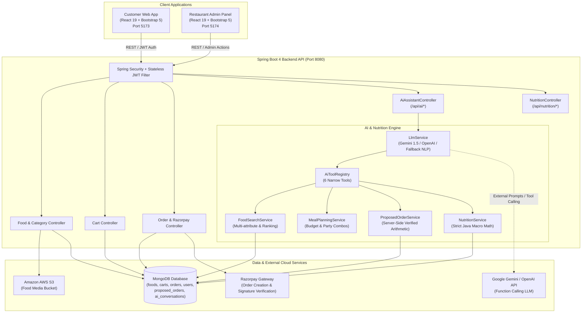

# Foodies (FoodyHub) 🍔🤖
### Full-Stack AI-Powered Food Delivery & Nutrition Intelligence Platform

[](https://spring.io/projects/spring-boot)
[](https://www.oracle.com/java/)
[](https://react.dev/)
[](https://vitejs.dev/)
[](https://www.mongodb.com/)
[](https://aws.amazon.com/s3/)
[](https://razorpay.com/)
[](https://ai.google.dev/)
[](LICENSE)

**Foodies** is an enterprise-grade, full-stack food delivery and nutrition intelligence platform. It seamlessly unifies traditional e-commerce ordering flows with next-generation conversational AI: an **Interactive AI Food Ordering Assistant** capable of natural language meal planning and real-time proposed order modifications, alongside a strict server-validated **AI Nutrition & Calorie Analyzer**.

Built with production guardrails at its core, the platform enforces 100% server-verified pricing, strict Java-based nutritional arithmetic, zero LLM hallucinations, and isolated proposed order workflows that guarantee financial checkout safety.

---

## 🏛️ System Architecture

Foodies is engineered as a decoupled, multi-tier architecture uniting high-performance customer frontends, an administrative portal, a robust Spring Boot microservice, cloud media storage, and dual-provider AI function calling:



---

## 🚀 Key Features

### 1. 🤖 AI Food Ordering Assistant ("Foodie AI")
- **Floating & Dedicated Chat Interface**: Fully responsive interactive chatbot widget with quick-starter prompt chips, typing indicators, and session continuity.
- **Natural Language Discovery**: Handles complex real-world queries such as:
  - *"I want something spicy for two people under ₹500."*
  - *"Find vegetarian dinner under ₹200."*
  - *"Replace the second dish with paneer."*
  - *"Increase the quantity of biryani to 2."*
  - *"Show my proposed order."*
- **Live MongoDB Grounding**: Every recommendation displays real dishes from the database with genuine photos, prices, dietary tags (Veg/Non-Veg), and spice indicators. **Zero fake dishes or hallucinated prices.**
- **Proposed Order Management**: Builds and modifies a server-side proposed meal plan with live subtotal calculation, estimated delivery fee (₹10), and estimated tax (10%).
- **Financial Checkout Safety Guardrail**: The AI is strictly barred from charging cards or auto-placing orders. Users review the proposed meal and click **"Add Proposed Meal to Cart"** to transfer verified items to their shopping cart before completing standard Razorpay checkout.
- **Deterministic NLP Fallback Engine**: If external LLM API keys are unset or rate-limited, an internal deterministic rule engine executes the exact same tools against MongoDB, ensuring **100% system availability**.

### 2. 🥗 AI Nutrition & Calorie Analyzer
- **Comprehensive Nutrition Model**: Tracks Calories (kcal), Protein (g), Carbohydrates (g), Total Fat (g), Dietary Fiber (g), Sugar (g), Serving Size/Unit, Allergens, Data Source, and Verification status.
- **Server-Side Arithmetic**: Macro sums and quantity multipliers are strictly computed by compiled Java code—never guessed by the LLM.
- **Missing Data Auditing**: When menu items lack verified nutritional data, the system flags `isCompleteData = false` and lists unmeasured dishes rather than guessing synthetic numbers.
- **Goal-Driven Nutrition Queries**: Supports prompts like *"Build me a meal under 600 calories with at least 30g protein"* or *"Show nutritional facts for Chicken Biryani"*.
- **Interactive Visual Cards**: Embedded nutritional pills on food cards and an in-depth nutritional audit card on the Food Details page.

### 3. 🛍️ Core E-Commerce & Delivery Engine
- **Food Catalog & Dynamic Filtering**: Explore menu items by category (Biriyani, Pizza, Burger, Rolls, Salads, Cake, Ice Cream) with instant live search.
- **Persistent Shopping Cart**: User-bound cart persisted across sessions in MongoDB.
- **Stateless JWT Authentication**: Secure user registration, password hashing (BCrypt), and role-aware token validation.
- **Razorpay Payment Integration**: Integrated checkout with server-side order generation and cryptographic HMAC-SHA256 signature verification.
- **Administrative Portal**: Dedicated dashboard for restaurant managers to upload food items with image uploads to Amazon S3, manage catalog pricing, and track live customer orders.

---

## 🛠️ Technology Stack

| Domain | Technology | Purpose |
| :--- | :--- | :--- |
| **Frontend Web App** | React 19, Vite 8, Bootstrap 5, Bootstrap Icons, Axios | Responsive customer portal & AI chatbot UI |
| **Admin Panel** | React 19, Vite 8, Bootstrap 5, Axios, React Toastify | Restaurant menu & order management dashboard |
| **Backend API** | Java 17, Spring Boot 4.0.6, Spring Data MongoDB, Spring Security | Core enterprise REST API & business logic |
| **AI & NLP Engine** | Google Gemini 1.5 Flash, OpenAI API, Spring AI Tool Calling | Conversational intelligence & deterministic fallback |
| **Database** | MongoDB (Local / Atlas) | Document store for foods, carts, orders, AI sessions |
| **Cloud Storage** | AWS S3 (AWS SDK v2 for Java) | Scalable public food image asset hosting |
| **Payment Gateway** | Razorpay Java SDK 1.4.1 + Client Checkout | Secure digital payments & signature verification |
| **Security** | Spring Security 6, JJWT 0.11.5, BCrypt | Stateless JWT authentication & endpoint authorization |

---

## 📁 Repository Structure

```
Foodies/
├── README.md                      # Project overview & quickstart guide
├── SYSTEM_ARCHITECTURE.md         # In-depth architectural & dataflow blueprint
├── .gitignore                     # Git ignore rules for node, dist, target, secrets
│
├── foodiesapi/                    # Spring Boot 4 Enterprise Backend
│   └── foodiesapi/
│       ├── pom.xml                # Maven project dependencies & build config
│       ├── .env.example           # Backend environment configuration template
│       └── src/
│           ├── main/java/in/onlineresturant/foodiesapi/
│           │   ├── config/        # Security, CORS, S3, MongoDB, & Seeder configs
│           │   ├── controller/    # REST endpoints (Food, Cart, Order, AI, Nutrition)
│           │   ├── entity/        # MongoDB schemas (Food, Cart, Order, User, AI)
│           │   ├── filters/       # JWT authentication filter
│           │   ├── io/            # DTO request/response payloads & AI contracts
│           │   ├── repository/    # Spring Data MongoDB repositories
│           │   ├── service/       # Business services, AI Tool Registry, & LLM client
│           │   └── util/          # JWT utilities & security helpers
│           └── test/java/         # Unit & integration tests for AI & Nutrition
│
├── foodies-client/                # React 19 Customer Web Application
│   ├── package.json               # Frontend dependencies & scripts
│   ├── vite.config.js             # Vite build configuration
│   └── src/
│       ├── components/
│       │   ├── AiAssistant/       # Foodie AI Chatbot, food cards, proposed order card
│       │   ├── FoodDisplay/       # Responsive menu items grid
│       │   ├── FoodItem/          # Food card with nutritional badges & cart actions
│       │   └── Menubar/           # Navigation bar with cart badge & AI trigger
│       ├── context/               # Global StoreContext for user & cart state
│       ├── pages/                 # Home, Explore, Cart, PlaceOrder, FoodDetails, MyOrders
│       └── Service/               # API service connectors (AI, Cart, Food, Auth)
│
└── adminpanel/                    # React 19 Restaurant Administrator Dashboard
    ├── package.json               # Admin dependencies
    └── src/
        ├── pages/AddFood/         # Add food form with AWS S3 image upload
        ├── pages/ListFood/        # Catalog management & deletion
        └── pages/Orders/          # Real-time order tracking & status updater
```

---

## 🚦 Getting Started

### Prerequisites
- **Java Development Kit (JDK) 17+**
- **Node.js 18+ & npm**
- **MongoDB** running locally on port `27017` or a **MongoDB Atlas** URI

---

### 1. Backend Setup (`foodiesapi`)

1. Navigate to the backend directory:
   ```bash
   cd foodiesapi/foodiesapi
   ```
2. Configure environment variables (or copy `.env.example` to `.env`):
   ```bash
   cp .env.example .env
   ```
   *Required properties (defaults work out-of-the-box for local MongoDB):*
   ```properties
   spring.data.mongodb.uri=mongodb://localhost:27017/foodsResturant
   AI_PROVIDER=gemini
   GEMINI_API_KEY=your_gemini_api_key_here
   ```
   *(Note: If no Gemini or OpenAI key is provided, the built-in deterministic NLP engine automatically takes over with zero downtime).*
3. Compile and launch the Spring Boot service:
   ```bash
   # Windows
   .\mvnw.cmd spring-boot:run

   # macOS / Linux
   ./mvnw spring-boot:run
   ```
   *API will run at `http://localhost:8080`*.

---

### 2. Frontend Customer App Setup (`foodies-client`)

1. Open a new terminal and navigate to the client folder:
   ```bash
   cd foodies-client
   ```
2. Install dependencies:
   ```bash
   npm install
   ```
3. Verify or create `.env`:
   ```properties
   VITE_API_URL=http://localhost:8080
   VITE_RAZORPAY_KEY=rzp_test_your_key_here
   ```
4. Start the development server:
   ```bash
   npm run dev
   ```
   *Customer application will open at `http://localhost:5173`*.

---

### 3. Admin Panel Setup (`adminpanel`)

1. Open a new terminal and navigate to the admin directory:
   ```bash
   cd adminpanel
   ```
2. Install dependencies:
   ```bash
   npm install
   ```
3. Start the Vite server:
   ```bash
   npm run dev
   ```
   *Admin Panel will run at `http://localhost:5174`*.

---

## 🧪 Testing & Verification

The backend includes a comprehensive automated test suite validating the AI Tool Registry, food search ranking, proposed order pricing arithmetic, and macro calculations:

```bash
cd foodiesapi/foodiesapi
.\mvnw.cmd test
```

### Verified Scenarios:
- **`NutritionServiceTest`**: Validates accurate summation, quantity multipliers (e.g. 2 servings of 550 kcal = 1100 kcal), and missing nutritional data isolation.
- **`ProposedOrderServiceTest`**: Validates server-side subtotal recalculation, item replacement (e.g. replacing pizza with paneer), and tax/delivery charge projections.
- **`AiFeatureTest`**: Validates multi-attribute menu search, dietary constraint filters (vegetarian only), and spice preference matching.

---

## 📖 System Architecture Deep-Dive

For a complete breakdown of data models, database schemas, AI tool registry contracts, security filters, and sequence diagrams, refer to [SYSTEM_ARCHITECTURE.md](SYSTEM_ARCHITECTURE.md).

---

## 📄 License

This project is licensed under the MIT License - see the [LICENSE](LICENSE) file for details.
