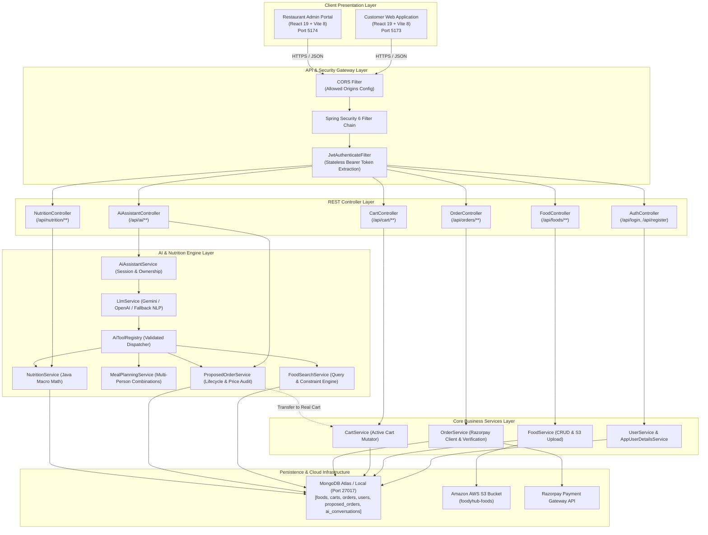
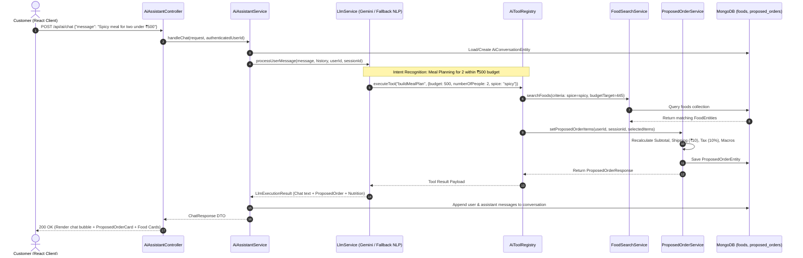
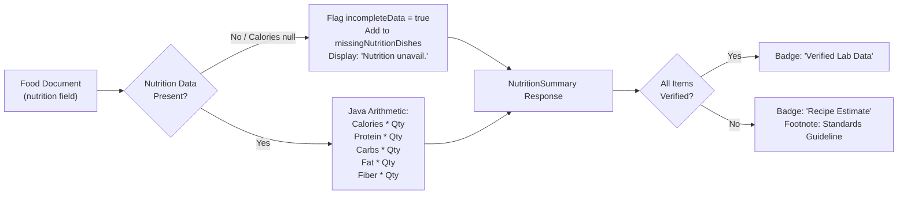
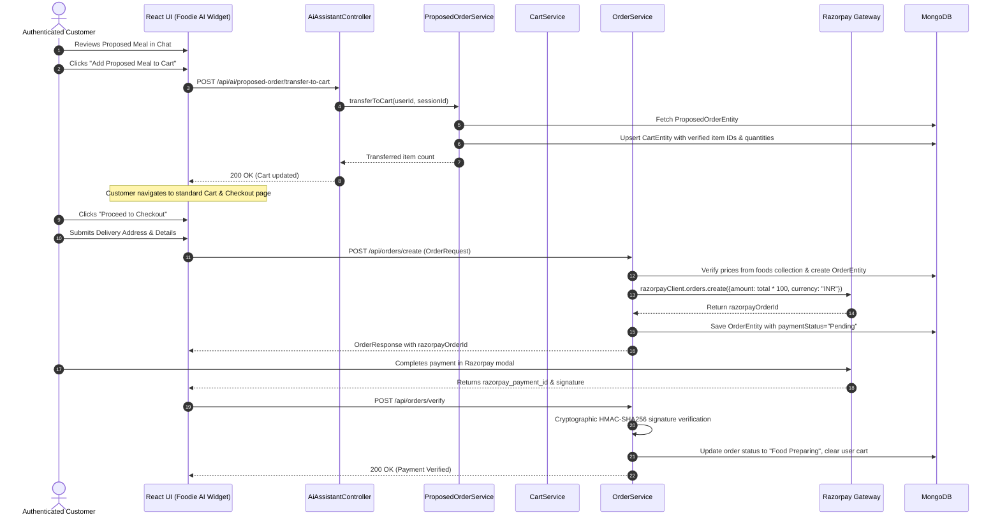
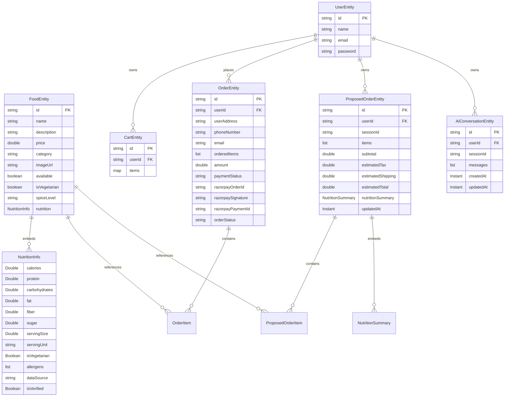

# Foodies Platform: System Architecture & Technical Specification 📐

This document provides a comprehensive technical breakdown of the architecture, subsystems, data flow pipelines, security guardrails, database models, and AI engine design powering the **Foodies (FoodyHub)** full-stack application.

---

## 1. Executive Architectural Overview

The Foodies application is engineered around a clean, layered micro-monolith backend paired with decoupled React customer and administrative frontends. The core innovation lies in the integration of an **AI Food Ordering Assistant** and an **AI Nutrition & Calorie Analyzer** that operate strictly as trusted services above live MongoDB data.

### Core Architectural Principles:
1. **Zero Hallucination Guarantee**: The AI engine never generates synthetic food items, imaginary discounts, or made-up prices. All recommendations are grounded in live database documents.
2. **Deterministic Server-Side Arithmetic**: Macro sums, item subtotals, tax (10%), and delivery charges (₹10) are strictly calculated by Java code in Spring Boot. The client and LLM outputs are treated as untrusted.
3. **Cart & Payment Safety Isolation**: The AI manages a detached `proposed_orders` document. The AI is structurally incapable of invoking payment APIs or finalizing orders. A user must deliberately review and transfer items to the real shopping cart (`carts`) to enter the standard Razorpay checkout flow.
4. **Dual AI Engine Resilience**: Supports external LLM providers (**Google Gemini 1.5 Flash** or **OpenAI**) with seamless automatic fallback to an internal deterministic NLP engine if credentials are not configured or rate limits are reached.

---

## 2. High-Level Component Architecture

---

## 3. Subsystem Breakdown

### 3.1 AI Food Ordering Assistant Subsystem

The assistant subsystem orchestrates natural language processing, user intent extraction, tool execution, and session management.

#### The 6 AI Backend Tools:
The LLM communicates exclusively through structured function calling using narrow, typed backend tools implemented in `AiToolRegistry`:

| Tool Name | Parameters | Responsibility |
| :--- | :--- | :--- |
| `searchAvailableFoods` | `query`, `category`, `maxPrice`, `isVegetarian`, `spicePreference`, `minProtein`, `maxCalories`, `limit` | Live search filtered by dietary constraints and price. Returns available menu items or closest alternatives. |
| `getFoodDetails` | `foodId` or `foodName` | Fetches comprehensive details for a specific dish directly from database. |
| `getFoodNutrition` | `foodId` or `foodName` | Retrieves macronutrient breakdown and data source verification for a dish. |
| `buildMealPlan` | `budget`, `numberOfPeople`, `isVegetarian`, `spicePreference`, `maxCalories`, `minProtein` | Assembles a balanced multi-dish meal combination fitting within budget accounting for taxes and delivery. |
| `modifyProposedOrder` | `action` (ADD, REMOVE, REPLACE, UPDATE_QTY, CLEAR), `foodId`, `foodName`, `replaceWithFoodName`, `quantity` | Modifies the server-side proposed order and recalculates verified subtotals. |
| `getProposedOrderSummary`| *(none)* | Returns the user's current proposed order, live pricing, and aggregated macro metrics. |

---

### 3.2 AI Nutrition & Calorie Analyzer Subsystem

The nutrition subsystem provides verified macronutrient calculations, dietary classification, and macro-constrained meal generation.

#### Key Nutrition Capabilities:
- **Zero Hallucination Policy**: If a dish in the database has no nutritional record, the engine returns `isCompleteData = false` with a clear label (`"Nutrition information unavailable"`). It never invents numbers.
- **Serving Scale Multipliers**: Total calories, proteins, carbohydrates, and fats scale deterministically with the ordered quantity ($C_{total} = \sum c_i \times q_i$).
- **Goal-Oriented Filtering**: High-protein and low-calorie searches query MongoDB using numerical operators ($Calories \le Max$ and $Protein \ge Min$).

---

### 3.3 Cart & Financial Checkout Safety Flow

To prevent accidental charges or unauthorized order placement by an AI model, proposed orders are completely isolated from active shopping carts until explicit human confirmation:

---

## 4. Database Schema & Data Models

All data is stored in MongoDB collections within the `foodsResturant` database:

---

## 5. Security Architecture & Threat Model

| Risk / Threat | Mitigation Mechanism | Implementation Location |
| :--- | :--- | :--- |
| **Price Tampering** | Client-supplied prices are strictly ignored. All item totals and subtotals are recalculated from database entities. | `ProposedOrderServiceImpl.java` `OrderServiceImpl.java` |
| **Unauthorized Data Access** | Every conversation and proposed order lookup verifies that `userId` matches the authenticated JWT principal. | `AiAssistantServiceImpl.java` `UserServiceImp.java` |
| **Hallucinated Orders** | The AI assistant has no access to the payment gateway or order creation services. Transfer to cart is an explicit user step. | `AiToolRegistry.java` `ProposedOrderService.java` |
| **External AI Downtime** | If Gemini or OpenAI is unavailable or rate-limited, an internal deterministic NLP fallback executes the exact same tools. | `LlmServiceImpl.java` |
| **Payment Signature Forgery** | Razorpay payment callbacks verify the HMAC-SHA256 signature using the secret key before marking orders as paid. | `OrderServiceImpl.java` |
| **Sensitive Credential Exposure** | Database credentials, JWT secret, AWS keys, and Razorpay secrets are bound via environment variables. | `application.properties` `.gitignore` |

---

## 6. REST API Endpoint Catalog

### Core Store & Menu Endpoints
- `GET /api/foods` — Retrieve list of all available food dishes.
- `GET /api/foods/{id}` — Retrieve detailed information for a single dish.
- `POST /api/foods` — (Admin) Add new food item with multipart image upload to AWS S3.
- `DELETE /api/foods/{id}` — (Admin) Delete food item and remove its image from S3.

### AI Assistant Endpoints
- `POST /api/ai/chat` — Process natural language queries, execute backend tools, and return chat response.
- `GET /api/ai/conversations/{conversationId}` — Retrieve conversation history for authenticated user or session.
- `GET /api/ai/proposed-order` — Retrieve current proposed meal plan and server-verified calculations.
- `PATCH /api/ai/proposed-order` — Mutate proposed order (add, remove, replace, update quantities).
- `DELETE /api/ai/proposed-order` — Clear current proposed order.
- `POST /api/ai/proposed-order/transfer-to-cart` — Safely move proposed items into the customer's active shopping cart.

### Nutrition Endpoints
- `GET /api/nutrition/food/{foodId}` — Retrieve verified nutritional data and data source for a dish.
- `POST /api/nutrition/calculate` — Compute aggregate macros across an arbitrary map of dish IDs and quantities.

### Cart & Checkout Endpoints
- `GET /api/cart` — Get items in active shopping cart for authenticated user.
- `POST /api/cart` — Add item to cart.
- `POST /api/cart/remove` — Decrease item quantity in cart.
- `DELETE /api/cart` — Clear all items in active cart.
- `POST /api/orders/create` — Create order entity and initiate Razorpay gateway order.
- `POST /api/orders/verify` — Verify Razorpay cryptographic payment signature.
- `GET /api/orders` — List user's historical orders.
- `GET /api/orders/all` — (Admin) List all customer orders.
- `PATCH /api/orders/status/{orderId}` — (Admin) Update preparation and delivery status.
